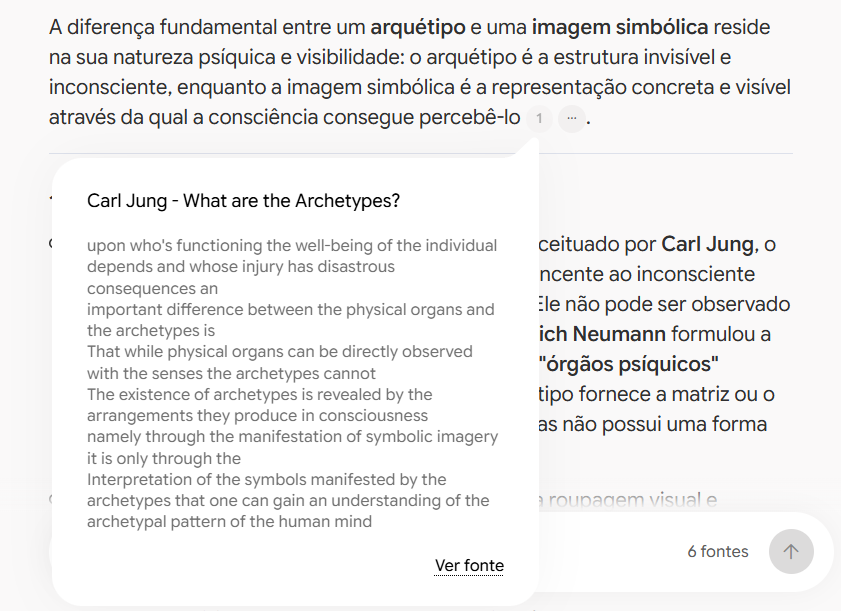

# Tarô arquetípico: símbolos, narrativas e autoconhecimento

Projeto desenvolvido para o desafio da DIO de construção de um segundo cérebro com IA, usando um caderno no NotebookLM e uma curadoria de fontes em texto e vídeo.

**Objetivo:** investigar como diferentes fontes interpretam os símbolos do tarô e sua relação com arquétipos, narrativas pessoais e reflexão sobre experiências.

[Acessar o caderno compartilhado](https://notebooklm.link.google/WExyMwJoPRP9)

O link acima foi fornecido durante o projeto. Seu acesso por outra conta ainda precisa ser conferido antes da submissão.

## Por que escolhi o tema

Meu interesse está na leitura simbólica das cartas e na construção de narrativas. O caderno reúne perspectivas históricas, semióticas e junguianas para estudar o assunto, comparar interpretações e reconhecer os limites de cada fonte. O recorte não busca realizar previsões nem demonstrar eficácia clínica.

## Curadoria: cinco fontes de pesquisa

| ID | Fonte e formato | Motivo da escolha e limite de uso |
| --- | --- | --- |
| F1 | Tim Husband — [Before Fortune-Telling: The History and Structure of Tarot Cards](https://www.metmuseum.org/perspectives/tarot-2). Artigo do Metropolitan Museum of Art, em inglês. | Autoria identificada, contexto museológico e referências a baralhos preservados. Base para contextualização histórica, sem transformar datas de registros em datas exatas de criação. |
| F2 | Lannoy Dorin — [Tarô e arquétipos](https://revistas.anchieta.br/index.php/revistaargumento/article/view/561). Artigo em português, Revista Argumento, 2003. [PDF oficial](https://revistas.anchieta.br/index.php/revistaargumento/article/download/561/480). | Apresenta uma leitura apoiada em Sallie Nichols, com referências e exemplos de cartas. Utilizado como abordagem interpretativa; suas afirmações históricas são comparadas com F1. |
| F3 | Cristina Gonçalves Skrebys Martinelli — [Os signos pictóricos das cartas de tarô como veículos narrativos](https://periodicos.uniso.br/triade/article/view/1775). Texto em português, revista Tríade, 2013. | Autoria e publicação acadêmica identificáveis. Contribui para o estudo das cartas como linguagem visual e narrativa. |
| F4 | Jung na Prática — [O Tarot e os Arquétipos — Jung Time 053](https://www.youtube.com/watch?v=B9M19NI_ELo). Vídeo em português, com Lino Bertrand. | Acrescenta uma exposição oral da abordagem junguiana aplicada ao tema. Suas proposições devem ser atribuídas ao orador; não são comprovação clínica. |
| F5 | Academy of Ideas — [Carl Jung — What are the Archetypes?](https://www.youtube.com/watch?v=wywUQc-4Opk). Vídeo em inglês. [Transcrição oficial](https://academyofideas.com/2017/02/carl-jung-what-are-archetypes/). | Introduz conceitos e identifica referências junguianas. A transcrição permite conferir passagens. O vídeo não trata especificamente de tarô. |

Foram selecionados três textos e dois vídeos. O artigo do Met apresentou dificuldade de importação por URL; a alternativa orientada foi salvar a página em PDF. A conclusão da inclusão das cinco fontes foi confirmada durante o projeto.

## Ferramentas e percurso

O caderno foi criado a partir de uma solicitação no Gemini. As primeiras perguntas, revisões e a elaboração do guia aconteceram no chat do Gemini. Essa distinção foi identificada durante a documentação.

Depois, uma pergunta foi feita diretamente no chat do caderno, com uma citação aberta e registrada em imagem. O mapa mental foi gerado no caderno.

O histórico do Gemini também foi adicionado ao notebook. Por isso, a captura mostra **seis fontes**: cinco referências de pesquisa e um histórico complementar produzido com IA. Esse histórico não é uma sexta referência independente. Recomenda-se desmarcá-lo nas próximas consultas para evitar que respostas anteriores sejam reutilizadas como evidência. Não foi confirmado se essa desmarcação já ocorreu.

## Diretriz de comportamento

A orientação abaixo foi usada no Gemini na etapa inicial. Seu registro como configuração permanente no próprio caderno não foi confirmado.

> Atue como um assistente de estudos sobre tarô arquetípico, com foco em símbolos, narrativas e autoconhecimento.
>
> Meu objetivo é investigar como diferentes fontes interpretam os símbolos do tarô e sua relação com arquétipos, narrativas pessoais e reflexão sobre experiências.
>
> Responda em português brasileiro, com linguagem acessível. Fundamente as respostas nas fontes selecionadas e apresente citações para conferência. Diferencie informações históricas, conceitos da psicologia junguiana e interpretações dos autores. Identifique quem propõe cada associação entre cartas e arquétipos, sem atribuir a Jung interpretações de outros autores. Compare divergências sem forçar concordância. Quando faltar informação, explique o que as fontes não permitem concluir. Mantenha o foco simbólico e cultural, sem previsões, diagnósticos ou alegações de eficácia terapêutica comprovada.

## Perguntas e resultados

As descrições abaixo são sínteses editoriais dos resultados, não transcrições literais.

### 1. Como as fontes contribuem para o estudo?

**Pergunta:** quais fontes ajudam a estudar a história do tarô e quais abordam arquétipos ou linguagem simbólica?

**Ambiente:** Gemini. Histórico nas páginas 1 a 6 do PDF.

**Resultado:** foram identificadas funções distintas: história em F1; interpretação arquetípica em F2 e F4; linguagem visual em F3; fundamentos teóricos em F5.

**Revisão:** a resposta inicial confundiu primeiras referências documentadas com criação do tarô e popularização com início da adivinhação. A comparação com F1 levou a pedidos de correção. F2 apresenta uma origem na Europa Central e raízes milenares; F1 registra referências italianas do século XV. A divergência foi mantida, sem fundir as duas afirmações.

### 2. Qual é a diferença entre arquétipo e imagem simbólica?

**Pergunta enviada ao caderno:** “Qual é a diferença entre um arquétipo e uma imagem simbólica, segundo as fontes deste caderno? Use O Eremita, conforme a análise de Lannoy Dorin, como exemplo. Identifique os autores das interpretações e inclua citações para conferir os trechos originais.”

**Resultado:** a resposta distinguiu a estrutura arquetípica de sua representação simbólica e apresentou O Eremita como exemplo. Identificou Neumann na analogia dos órgãos psíquicos e Edinger na distinção entre signo e símbolo.

**Fontes relacionadas:** F5 para os conceitos; F2, especialmente a página impressa 54, para O Eremita. A captura abaixo comprova a citação de F5 aberta no caderno; não comprova a conferência de todas as afirmações da resposta.

**Observação editorial:** na resposta, Cronos/Saturno aparece próximo da definição do arquétipo. Convém distinguir a figura mitológica associada à carta por Dorin da estrutura abstrata discutida na teoria.

## Materiais e evidências

Todos os arquivos abaixo ficam na raiz do repositório, junto deste README, sem subpastas.

| Arquivo | Conteúdo |
| --- | --- |
| [Mapa mental original](mapa-mental-original.png) | Exportação do caderno, preservada sem alterações e com limitações descritas abaixo. |
| [Guia de estudos revisado](guia-de-estudos-revisado.md) | Guia com glossário, perguntas e referências, gerado no Gemini e revisado com apoio do ChatGPT. |
| [Captura com citação](resposta-com-citacao.png) | Evidência direta da resposta no caderno vinculada ao trecho de F5. |
| [Histórico do Gemini](historico-gemini.pdf) | Registro original das interações e revisões, incluindo respostas iniciais que depois foram corrigidas. |
| [Notas de revisão](notas-de-revisao.md) | Correções e limitações dos materiais. |

## Aprendizados e limites

Uma resposta fluida pode extrapolar o texto consultado. Pedidos de revisão ajudaram a recuperar diferenças entre origem, registro documental e popularização.

O mapa mental repetiu imprecisões históricas já discutidas no chat. Isso mostrou que cada material gerado precisa de conferência própria. O histórico foi preservado como evidência do processo, sem ser tratado como fonte especializada.

As referências sustentam o estudo de interpretações simbólicas. A seleção não constitui uma revisão sistemática nem permite estabelecer eficácia terapêutica. As falas do vídeo em português não foram conferidas integralmente nesta revisão.

## Antes da submissão

- [ ] Registrar a diretriz também no caderno, caso ainda não tenha sido feito.
- [ ] Conferir o acesso ao link do notebook com outra conta.
- [ ] Conferir as permissões das fontes compartilhadas e a ausência de dados pessoais.
- [ ] Publicar os arquivos deste pacote em um repositório público na própria conta.
- [ ] Abrir os links e arquivos pelo GitHub após o envio.
- [ ] Submeter à DIO o endereço do repositório, não apenas o link do notebook.

